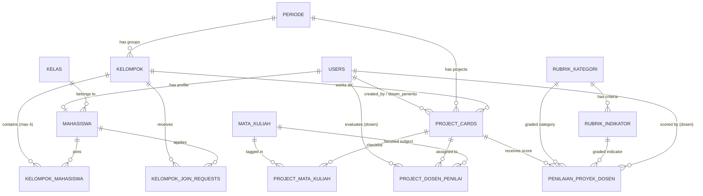

# Dokumentasi & Spesifikasi Skema Database PBL App

Dokumen ini disusun berdasarkan kebutuhan pada catatan spesifikasi sistem:
- **Login & Profil**: Login via Gmail/Google, pengisian profil mandiri, pemilihan kelompok mandiri (maksimal 4 orang, semester yang sama).
- **Pembentukan Kelompok & Request Join**: Maksimal 4 orang, filter mahasiswa satu semester, sistem request join ke kelompok lain, mahasiswa yang sudah memiliki kelompok otomatis disembunyikan dari daftar pilihan.
- **Mekanisme Proyek (Internal vs External)**: 
  - *Internal*: Pilih topik proyek, dosen penentu proyek, opsi lomba/mandiri (mitra opsional/tidak wajib).
  - *External*: Wajib menyertakan data mitra industri.
- **Mata Kuliah & Checklist Proyek**:
  - Master data mata kuliah dikelompokkan berdasarkan semester.
  - Setiap proyek memiliki checklist mata kuliah relevan yang dibatasi sesuai semester kelompok.
- **Penilaian Dosen & Rubrik Dinamis**:
  - Role Dosen dengan hak akses menilai proyek berdasarkan keterkaitan mata kuliah yang diampu.
  - Admin dapat menentukan/menugaskan dosen penilai untuk setiap proyek.
  - Rubrik penilaian dinamis (Admin dapat mengelola kategori, kriteria, dan bobot).
  - Seeder default 4 kategori hasil proyek: **Kesesuaian Matkul**, **Kualitas dan Fungsi**, **Inovasi**, dan **Estetik**.

---

## 1. Diagram Relasi Entitas (ERD)

---

## 2. Struktur Tabel & Perubahan Skema

### A. Tabel Autentikasi & Pengguna

#### 1. `users` (Pembaruan)
Tabel akun untuk semua pengguna sistem.
| Kolom | Tipe Data | Keterangan |
| :--- | :--- | :--- |
| `id` | `BIGINT UNSIGNED AUTO_INCREMENT` | Primary Key |
| `uuid` | `UUID UNIQUE` | Route binding publik |
| `nama_user` | `VARCHAR(255)` | Nama lengkap pengguna |
| `email` | `VARCHAR(255) UNIQUE` | Email pengguna (Gmail / SSO kampus) |
| `email_verified_at` | `TIMESTAMP NULL` | Status verifikasi email |
| `google_id` | `VARCHAR(255) NULL UNIQUE` | **Baru**: ID akun Google OAuth untuk login Gmail |
| `avatar` | `VARCHAR(255) NULL` | **Baru**: URL avatar dari Google profile |
| `no_hp` | `VARCHAR(30) NULL` | Nomor kontak WhatsApp/telepon |
| `username` | `VARCHAR(100) UNIQUE` | Username unik |
| `password` | `VARCHAR(255)` | Password hash (opsional jika login OAuth murni) |
| `role` | `ENUM('admin', 'dosen', 'evaluator', 'mahasiswa')` | **Pembaruan**: Ditambahkan role `dosen` |
| `profile_photo_path` | `VARCHAR(255) NULL` | Lokasi upload foto profil lokal |
| `remember_token` | `VARCHAR(100) NULL` | Sesi token |
| `created_at`, `updated_at` | `TIMESTAMP` | Audit log waktu |

---

### B. Tabel Akademik & Mahasiswa

#### 2. `mahasiswa` (Pembaruan)
Profil biodata mahasiswa yang diisi mandiri setelah login.
| Kolom | Tipe Data | Keterangan |
| :--- | :--- | :--- |
| `id` | `BIGINT UNSIGNED AUTO_INCREMENT` | Primary Key |
| `uuid` | `UUID UNIQUE` | UUID publik |
| `user_id` | `FOREIGN KEY (users.id) CASCADE` | 1 User Mahasiswa : 1 Profil Mahasiswa |
| `kelas_id` | `FOREIGN KEY (kelas.id) NULL` | Kelas akademik mahasiswa |
| `nim` | `VARCHAR(50) UNIQUE` | Nomor Induk Mahasiswa |
| `nama_mahasiswa` | `VARCHAR(255)` | Nama lengkap mahasiswa |
| `semester` | `TINYINT UNSIGNED DEFAULT 1` | **Baru**: Semester aktif mahasiswa (1 - 8) |
| `is_profile_complete` | `BOOLEAN DEFAULT FALSE` | **Baru**: Penanda kelengkapan profil mandiri |
| `created_at`, `updated_at` | `TIMESTAMP` | Timestamp |

#### 3. `kelas` (Pembaruan)
Data master kelas akademik.
| Kolom | Tipe Data | Keterangan |
| :--- | :--- | :--- |
| `id` | `BIGINT UNSIGNED AUTO_INCREMENT` | Primary Key |
| `uuid` | `UUID UNIQUE` | UUID publik |
| `kelas` | `VARCHAR(50) UNIQUE` | Nama kelas (e.g. "2A", "3B", "4C") |
| `semester` | `TINYINT UNSIGNED NULL` | **Baru**: Semester default kelas (e.g. 2, 3, 4) |
| `created_at`, `updated_at` | `TIMESTAMP` | Timestamp |

---

### C. Pembentukan Kelompok & Request Join

#### 4. `kelompok` (Pembaruan)
Kelompok kerja mahasiswa untuk proyek PBL.
| Kolom | Tipe Data | Keterangan |
| :--- | :--- | :--- |
| `id` | `BIGINT UNSIGNED AUTO_INCREMENT` | Primary Key |
| `uuid` | `UUID UNIQUE` | UUID publik |
| `periode_id` | `FOREIGN KEY (periode.id) CASCADE` | Periode aktif berjalan |
| `nama_kelompok` | `VARCHAR(100)` | Nama kelompok (unik per periode) |
| `semester` | `TINYINT UNSIGNED` | **Baru**: Semester kelompok (semua anggota wajib sama) |
| `max_members` | `TINYINT UNSIGNED DEFAULT 4` | **Baru**: Batas maksimal anggota (maksimal 4 orang) |
| `status_bergabung` | `ENUM('terbuka', 'penuh', 'terkunci') DEFAULT 'terbuka'` | **Baru**: Status penerimaan anggota |
| `link_drive` | `VARCHAR(255) NULL` | Repositori/Drive berkas kelompok |
| `created_at`, `updated_at` | `TIMESTAMP` | Timestamp |

#### 5. `kelompok_mahasiswa` (Pivot Anggota Kelompok)
Relasi anggota kelompok dengan batasan ketat.
| Kolom | Tipe Data | Keterangan |
| :--- | :--- | :--- |
| `id` | `BIGINT UNSIGNED AUTO_INCREMENT` | Primary Key |
| `kelompok_id` | `FOREIGN KEY (kelompok.id) CASCADE` | ID Kelompok |
| `mahasiswa_id` | `FOREIGN KEY (mahasiswa.id) CASCADE` | ID Mahasiswa |
| `periode_id` | `FOREIGN KEY (periode.id) CASCADE` | Periode aktif |
| `role` | `ENUM('Ketua', 'Anggota') DEFAULT 'Anggota'` | Peran dalam kelompok |
| `created_at`, `updated_at` | `TIMESTAMP` | Timestamp |
| *Constraints* | `UNIQUE(kelompok_id, mahasiswa_id)` `UNIQUE(periode_id, mahasiswa_id)` | 1 mahasiswa hanya boleh memiliki 1 kelompok per periode |

#### 6. `kelompok_join_requests` (Tabel Baru)
Menampung permintaan bergabung mahasiswa ke kelompok lain yang masih membuka slot (< 4 orang dan semester sama).
| Kolom | Tipe Data | Keterangan |
| :--- | :--- | :--- |
| `id` | `BIGINT UNSIGNED AUTO_INCREMENT` | Primary Key |
| `uuid` | `UUID UNIQUE` | UUID publik |
| `kelompok_id` | `FOREIGN KEY (kelompok.id) CASCADE` | Kelompok tujuan request |
| `mahasiswa_id` | `FOREIGN KEY (mahasiswa.id) CASCADE` | Mahasiswa pemohon |
| `status` | `ENUM('pending', 'approved', 'rejected', 'canceled') DEFAULT 'pending'` | Status permohonan |
| `pesan` | `TEXT NULL` | Catatan/pesan permohonan bergabung |
| `responded_by` | `FOREIGN KEY (users.id) NULL` | Ketua kelompok / admin yang merespons |
| `responded_at` | `TIMESTAMP NULL` | Waktu persetujuan/penolakan |
| `created_at`, `updated_at` | `TIMESTAMP` | Timestamp |
| *Constraints* | `INDEX(kelompok_id, status)` | Optimasi filter request aktif |

---

### D. Manajemen Proyek (Internal vs External)

#### 7. `project_cards` (Pembaruan)
Kartu proyek kanban dengan diferensiasi mekanisme proyek.
| Kolom | Tipe Data | Keterangan |
| :--- | :--- | :--- |
| `id` | `BIGINT UNSIGNED AUTO_INCREMENT` | Primary Key |
| `uuid` | `UUID UNIQUE` | UUID publik |
| `kelompok_id` | `FOREIGN KEY (kelompok.id) CASCADE` | Kelompok pemilik proyek |
| `periode_id` | `FOREIGN KEY (periode.id) CASCADE` | Periode proyek |
| `list_id` | `FOREIGN KEY (project_lists.id) NULL` | Kolom papan kanban |
| `title` | `VARCHAR(255)` | Judul proyek |
| `description` | `TEXT NULL` | Deskripsi proyek |
| **`jenis_proyek`** | `ENUM('internal', 'external') DEFAULT 'internal'` | **Baru**: Tipe proyek internal atau external |
| **`topik_proyek`** | `VARCHAR(255) NULL` | **Baru**: Topik proyek (internal) |
| **`sumber_proyek`** | `ENUM('dosen', 'lomba', 'mandiri', 'lainnya') NULL` | **Baru**: Asal proyek internal |
| **`dosen_penentu_id`**| `FOREIGN KEY (users.id) NULL` | **Baru**: Dosen yang menentukan project (jika internal) |
| `nama_mitra` | `VARCHAR(255) NULL` | Wajib jika `jenis_proyek = external` |
| `kontak_mitra` | `VARCHAR(255) NULL` | Wajib jika `jenis_proyek = external` |
| `alamat_mitra` | `TEXT NULL` | Alamat instansi/mitra |
| `skema_pbl` | `VARCHAR(50) NULL` | Skema PBL |
| `status_proyek` | `VARCHAR(20) DEFAULT 'Proses'` | Status pengerjaan |
| `link_drive_proyek` | `VARCHAR(255) NULL` | Berkas luaran proyek |
| `progress` | `TINYINT UNSIGNED DEFAULT 0` | Persentase progres (0 - 100) |
| `biaya_barang`, `biaya_jasa` | `DECIMAL(15,2) DEFAULT 0` | Rincian anggaran biaya |
| `tanggal_mulai`, `tanggal_selesai` | `DATE NULL` | Rentang waktu pengerjaan |
| `created_by`, `updated_by` | `FOREIGN KEY (users.id) NULL` | Audit pembuat/pengubah |
| `created_at`, `updated_at` | `TIMESTAMP` | Timestamp |

---

### E. Master Data Mata Kuliah & Checklist per Proyek

#### 8. `mata_kuliah` (Tabel Baru)
Master data mata kuliah terstruktur berdasarkan semester.
| Kolom | Tipe Data | Keterangan |
| :--- | :--- | :--- |
| `id` | `BIGINT UNSIGNED AUTO_INCREMENT` | Primary Key |
| `uuid` | `UUID UNIQUE` | UUID publik |
| `kode_matkul` | `VARCHAR(50) UNIQUE` | Kode mata kuliah (e.g. "MK301") |
| `nama_matkul` | `VARCHAR(255)` | Nama mata kuliah |
| `semester` | `TINYINT UNSIGNED` | Semester mata kuliah (1 - 8) |
| `sks` | `TINYINT UNSIGNED DEFAULT 2` | Bobot SKS |
| `deskripsi` | `TEXT NULL` | Deskripsi capaian pembelajaran |
| `is_active` | `BOOLEAN DEFAULT TRUE` | Status aktif |
| `created_at`, `updated_at` | `TIMESTAMP` | Timestamp |
| *Constraints* | `INDEX(semester, is_active)` | Filter cepat mata kuliah per semester |

#### 9. `project_mata_kuliah` (Tabel Baru - Pivot Checklist)
Menyimpan checklist mata kuliah yang terkait dengan suatu proyek.
| Kolom | Tipe Data | Keterangan |
| :--- | :--- | :--- |
| `id` | `BIGINT UNSIGNED AUTO_INCREMENT` | Primary Key |
| `project_card_id` | `FOREIGN KEY (project_cards.id) CASCADE` | ID Kartu Proyek |
| `mata_kuliah_id` | `FOREIGN KEY (mata_kuliah.id) CASCADE` | ID Mata Kuliah yang diceklist |
| `created_at`, `updated_at` | `TIMESTAMP` | Timestamp |
| *Constraints* | `UNIQUE(project_card_id, mata_kuliah_id)` | Mencegah duplikasi checklist |

> [!NOTE]
> **Aturan Validasi Checklist**: Mata kuliah yang dapat dipilih pada proyek **hanya** mata kuliah yang memiliki `semester` sama dengan `semester` kelompok/proyek tersebut.

---

### F. Hak Akses Dosen Penilai Proyek & Rubrik Penilaian Dinamis

#### 10. `project_dosen_penilai` (Tabel Baru)
Daftar dosen yang ditugaskan oleh Admin untuk menilai proyek tertentu.
| Kolom | Tipe Data | Keterangan |
| :--- | :--- | :--- |
| `id` | `BIGINT UNSIGNED AUTO_INCREMENT` | Primary Key |
| `project_card_id` | `FOREIGN KEY (project_cards.id) CASCADE` | Proyek yang dinilai |
| `dosen_id` | `FOREIGN KEY (users.id) CASCADE` | User dosen penilai |
| `mata_kuliah_id` | `FOREIGN KEY (mata_kuliah.id) NULL` | Mata kuliah spesifik pengampu (opsional) |
| `status_penilaian` | `ENUM('belum', 'proses', 'selesai') DEFAULT 'belum'` | Status progres evaluasi dosen |
| `assigned_by` | `FOREIGN KEY (users.id) NULL` | Admin yang menugaskan |
| `created_at`, `updated_at` | `TIMESTAMP` | Timestamp |
| *Constraints* | `UNIQUE(project_card_id, dosen_id, mata_kuliah_id)` | Dosen penilai unik per matkul/proyek |

#### 11. `rubrik_kategori` (Tabel Baru - Dinamis)
Kategori utama rubrik penilaian dinamis yang dapat dikelola oleh Admin.
| Kolom | Tipe Data | Keterangan |
| :--- | :--- | :--- |
| `id` | `BIGINT UNSIGNED AUTO_INCREMENT` | Primary Key |
| `uuid` | `UUID UNIQUE` | UUID publik |
| `kode` | `VARCHAR(50) UNIQUE` | Kode kategori (slug) |
| `nama_kategori` | `VARCHAR(150)` | Nama kategori rubrik |
| `bobot` | `DECIMAL(5,2) DEFAULT 25.00` | Bobot penilaian (persen 0 - 100) |
| `deskripsi` | `TEXT NULL` | Penjelasan kriteria kategori |
| `urutan` | `TINYINT UNSIGNED DEFAULT 0` | Urutan tampilan di form penilaian |
| `is_active` | `BOOLEAN DEFAULT TRUE` | Status aktif/dinonaktifkan |
| `created_at`, `updated_at` | `TIMESTAMP` | Timestamp |

#### 12. `rubrik_indikator` (Tabel Baru - Sub-Indikator Dinamis)
Indikator atau butir penilaian di bawah kategori rubrik.
| Kolom | Tipe Data | Keterangan |
| :--- | :--- | :--- |
| `id` | `BIGINT UNSIGNED AUTO_INCREMENT` | Primary Key |
| `uuid` | `UUID UNIQUE` | UUID publik |
| `kategori_id` | `FOREIGN KEY (rubrik_kategori.id) CASCADE` | Relasi ke kategori induk |
| `kode` | `VARCHAR(50) UNIQUE` | Kode indikator |
| `nama_indikator` | `VARCHAR(255)` | Deskripsi butir penilaian |
| `bobot` | `DECIMAL(5,2) DEFAULT 100.00` | Bobot relatif dalam kategori |
| `skala_min` | `DECIMAL(5,2) DEFAULT 0` | Skor minimum |
| `skala_max` | `DECIMAL(5,2) DEFAULT 100` | Skor maksimum |
| `urutan` | `TINYINT UNSIGNED DEFAULT 0` | Urutan butir |
| `is_active` | `BOOLEAN DEFAULT TRUE` | Status aktif |
| `created_at`, `updated_at` | `TIMESTAMP` | Timestamp |

#### 13. `penilaian_proyek_dosen` (Tabel Baru - Input Nilai Dosen)
Menyimpan penilaian dari setiap dosen penilai untuk proyek dan indikator rubrik.
| Kolom | Tipe Data | Keterangan |
| :--- | :--- | :--- |
| `id` | `BIGINT UNSIGNED AUTO_INCREMENT` | Primary Key |
| `uuid` | `UUID UNIQUE` | UUID publik |
| `project_card_id` | `FOREIGN KEY (project_cards.id) CASCADE` | Kartu proyek yang dinilai |
| `dosen_id` | `FOREIGN KEY (users.id) CASCADE` | Dosen yang memberi nilai |
| `mata_kuliah_id` | `FOREIGN KEY (mata_kuliah.id) NULL` | Keterkaitan mata kuliah yang dinilai |
| `rubrik_kategori_id` | `FOREIGN KEY (rubrik_kategori.id) CASCADE` | Kategori rubrik yang dinilai |
| `rubrik_indikator_id` | `FOREIGN KEY (rubrik_indikator.id) NULL` | Indikator spesifik (jika dinilai per butir) |
| `nilai` | `DECIMAL(5,2)` | Skor nilai (0.00 - 100.00) |
| `catatan_umpan_balik` | `TEXT NULL` | Komentar / masukan perbaikan dosen |
| `created_at`, `updated_at` | `TIMESTAMP` | Timestamp |
| *Constraints* | `UNIQUE(project_card_id, dosen_id, mata_kuliah_id, rubrik_kategori_id, rubrik_indikator_id)` | Mencegah input ganda |

---

## 3. Data Seeder Default: 4 Kategori Rubrik Hasil Proyek

Sesuai spesifikasi, seeder default memuat 4 kategori hasil proyek berikut:

| No | Kode | Nama Kategori | Bobot Usulan | Deskripsi Evaluasi |
| :--- | :--- | :--- | :--- | :--- |
| 1 | `kesesuaian_matkul` | **Kesesuaian Matkul** | 25% | Mengukur sejauh mana implementasi produk proyek memenuhi capaian pembelajaran mata kuliah semester terkait. |
| 2 | `kualitas_fungsi` | **Kualitas dan Fungsi** | 35% | Mengukur keandalan sistem, kelengkapan fitur teknis, arsitektur kode, stabilitas, dan ketiadaan error fatal. |
| 3 | `inovasi` | **Inovasi** | 20% | Mengukur orisinalitas ide, kebaruan pendekatan teknologi, nilai diferensiasi solusi, dan daya saing karya. |
| 4 | `estetik` | **Estetik** | 20% | Mengukur kenyamanan antarmuka (UI/UX), kerapihan visual, konsistensi desain, dan keramahan bagi pengguna. |

---

## 4. Alur & Logika Bisnis (Business Rules)

### 1. Alur Login & Registrasi Profil Mandiri
1. Mahasiswa login dengan Gmail (Google OAuth) atau akun terdaftar.
2. Jika profil mahasiswa belum lengkap (`is_profile_complete = false`), diarahkan ke halaman isi biodata mandiri:
   - NIM
   - Nama Lengkap
   - Pemilihan Kelas & Semester
   - Nomor WhatsApp
   - Foto Profil
3. Setelah profil lengkap, mahasiswa mendapatkan akses ke dashboard pembentukan kelompok dan proyek.

### 2. Alur Pembentukan Kelompok & Request Join
1. **Buat Kelompok Mandiri**:
   - Mahasiswa yang belum punya kelompok dapat membuat kelompok baru.
   - Sistem menetapkan `semester` kelompok otomatis mengikuti `semester` pembuatnya.
   - Pembuat kelompok otomatis menjadi `Ketua`.
2. **Pencarian Anggota & Batasan 4 Orang**:
   - Ketua dapat mencari mahasiswa lain. Mahasiswa yang **sudah memiliki kelompok** pada periode aktif otomatis tidak muncul di daftar pencarian.
   - Mahasiswa yang dicari wajib berada di semester yang sama.
   - Total anggota tidak boleh melebihi 4 orang.
3. **Mekanisme Request Join**:
   - Mahasiswa tanpa kelompok dapat melihat daftar kelompok yang masih terbuka (`status_bergabung = 'terbuka'` dan anggota < 4) pada semesternya.
   - Mahasiswa mengirimkan request join (`kelompok_join_requests`).
   - Ketua kelompok mendapatkan notifikasi dan dapat menyetujui (`approved`) atau menolak (`rejected`).
   - Jika disetujui, mahasiswa otomatis masuk ke `kelompok_mahasiswa`. Jika kelompok mencapai 4 orang, statusnya otomatis berubah menjadi `penuh`.

### 3. Alur Mekanisme Proyek: Internal vs External
1. **Proyek Internal**:
   - Mahasiswa menentukan topik proyek.
   - Memilih asal sumber proyek: `dosen` (proyek dari dosen pembimbing/pengampu), `lomba` (proyek kompetisi), atau `mandiri`.
   - Admin/Dosen dapat memvalidasi topik proyek.
   - Kolom mitra opsional (boleh dikosongkan).
2. **Proyek External**:
   - Proyek yang bekerja sama dengan industri/UMKM/instansi luar.
   - Form mewajibkan pengisian `nama_mitra` dan `kontak_mitra`.

### 4. Alur Checklist Mata Kuliah
1. Sistem menyajikan daftar mata kuliah aktif dari tabel `mata_kuliah` di mana `mata_kuliah.semester == kelompok.semester`.
2. Mahasiswa mencentang mata kuliah yang relevan dengan luaran proyek mereka.
3. Data tersimpan di `project_mata_kuliah`.

### 5. Alur Penugasan & Penilaian Dosen
1. Admin membuka menu Proyek / Evaluasi, lalu memilih proyek tertentu.
2. Admin menginput dosen-dosen yang ditugaskan menilai proyek tersebut melalui form penugasan (`project_dosen_penilai`), sekaligus dapat menentukan fokus mata kuliah pengampu.
3. Dosen yang login melihat daftar proyek yang ditugaskan kepadanya.
4. Dosen mengisi skor untuk masing-masing dari 4 kategori rubrik (**Kesesuaian Matkul**, **Kualitas dan Fungsi**, **Inovasi**, **Estetik**), serta memberikan catatan evaluasi terkait mata kuliah yang relevan.
5. Nilai akhir proyek dikalkulasikan secara otomatis berdasarkan bobot dinamis pada kategori rubrik.